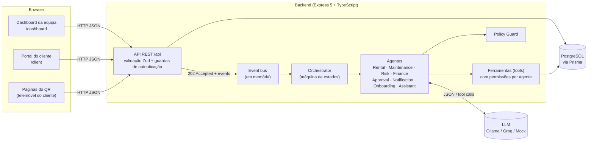

# 01 — Arquitetura

## Visão geral



**Ideia central:** a API **não decide nada**. Quando um pedido chega, a API grava-o, responde de imediato
`202 Accepted` e emite um evento. O **Orchestrator** reage ao evento e conduz o pedido pelos agentes, em
segundo plano. O frontend vai consultando o estado (polling) e mostra o progresso.

## Camadas do backend

| Camada | Pasta | Responsabilidade |
|---|---|---|
| Rotas | `backend/src/routes` | Mapa de endpoints e que guarda de autenticação se aplica a cada um |
| Middleware | `backend/src/middleware` | Autenticação (`requireStaff`, `requireCustomer`, `optionalCustomer`) |
| Controllers | `backend/src/controllers` | Lêem o pedido HTTP, validam com Zod, chamam serviços e emitem eventos |
| Modelos de entrada | `backend/src/models/schemas.ts` | Esquemas Zod: valida só a **forma** dos dados; as regras de negócio ficam com os agentes |
| Serviços | `backend/src/services` | Acesso a dados e operações de domínio (alugueres, clientes, pagamentos, auditoria…) |
| Eventos | `backend/src/events/eventBus.ts` | Event bus tipado: `rental.requested`, `monitoring.tick`, `customer.registered` |
| Agentes | `backend/src/agents` | Um diretório por agente, com as suas **regras** (`rules.ts`) e a sua classe |
| Ferramentas | `backend/src/tools` | As únicas operações que um agente pode fazer, com a lista de permissões por agente |
| LLM | `backend/src/llm` | Fornecedores de modelo: `openai-compatible` e `mock` |
| Configuração | `backend/src/config` | Variáveis de ambiente (validadas) e **regras de negócio** num só ficheiro |

## Estrutura de pastas

```
ai-equipment-rental/
├── start-demo.ps1                 # arranca API + frontend (+ ngrok, se existir)
├── backend/
│   ├── prisma/
│   │   ├── schema.prisma          # modelo de dados
│   │   ├── migrations/            # histórico de migrações SQL
│   │   └── seed.ts                # entrada do seed (usa src/database/seed.ts)
│   ├── scripts/
│   │   ├── run-scenarios.ts       # corre os cenários de demonstração de ponta a ponta
│   │   ├── create-demo-accounts.ts# cria/atualiza as contas de demo sem apagar dados
│   │   ├── llm-smoke-test.ts      # testa a ligação ao LLM
│   │   └── try-assistant.ts       # conversa com o assistente pela linha de comandos
│   ├── tests/rules.test.ts        # testes das regras e do Policy Guard
│   └── src/
│       ├── agents/
│       │   ├── core/              # BaseAgent, MonitoringAgent, Policy Guard, passos do LLM
│       │   ├── orchestrator/      # Orchestrator + tabela de transições
│       │   ├── rental/  maintenance/  risk/  finance/
│       │   ├── approval/          # decisão final + triagem de anomalias
│       │   ├── notification/  assistant/  onboarding/
│       ├── tools/                 # ferramentas + permissions.ts
│       ├── services/  controllers/  routes/  middleware/
│       ├── config/  database/  events/  llm/  models/  utils/
│       ├── app.ts                 # cria a app Express
│       └── server.ts              # arranque: Orchestrator, retoma, agendador
└── frontend/
    └── src/
        ├── views/
        │   ├── public/            # páginas do QR (pedido + estado)
        │   ├── portal/            # login, registo e portal do cliente
        │   ├── auth/              # login da equipa
        │   └── dashboard/         # páginas do dashboard
        ├── components/            # layout, agentes, gráficos, UI base
        ├── services/              # clientes da API + sessão
        ├── router/                # rotas + guardas de acesso
        └── utils/  types/  composables/
```

## Arranque do servidor

O ficheiro `server.ts`:
1. Regista o Orchestrator no event bus.
2. Abre a API na porta `PORT` (3000 por omissão).
3. **Retoma o trabalho interrompido.** O estado de cada workflow está na base de dados, por isso um pedido
   ou um registo de cliente a meio quando o servidor parou continua do ponto onde estava.
4. Inicia o **agendador de monitorização**, a cada `MONITORING_INTERVAL_MS` (15 min por omissão; `0`
   desliga-o).

## Eventos

| Evento | Quem emite | Quem reage | Efeito |
|---|---|---|---|
| `rental.requested` | `POST /public/equipment/:code/rental-requests` | Orchestrator | Conduz o pedido pelo workflow |
| `monitoring.tick` | Agendador ou `POST /monitoring/run` | Orchestrator | Corre um ciclo de monitorização |
| `customer.registered` | `POST /auth/customer/register` | Orchestrator → Onboarding Agent | Ativa ou rejeita a conta |

O event bus é em memória (`EventEmitter`). Em produção seria uma fila (BullMQ/Redis, SQS) com os mesmos
nomes de evento. A arquitetura não muda, só o transporte.

## Fornecedor de LLM

`backend/src/llm/index.ts` escolhe o fornecedor a partir de `LLM_PROVIDER`:

- **`openai-compatible`**: qualquer endpoint `/chat/completions` compatível com OpenAI, com *tool calling*
  e respostas JSON. Exemplos: Ollama local (`qwen2.5:3b`), Groq (`llama-3.3-70b-versatile`), OpenRouter.
- **`mock`**: modelo "cooperativo" com respostas programadas. Chama todas as ferramentas oferecidas e dá
  avaliações benignas. Serve para demonstrações offline e testes determinísticos. **Tudo o resto (regras,
  permissões, Policy Guard, auditoria) corre exatamente igual.**

> Com o Ollama em CPU, um pedido aprovado demora cerca de 2–3 minutos, porque cada agente faz uma ou mais
> chamadas ao modelo. Para uma demonstração ao vivo mais rápida, usa o Groq ou o `mock`.

## Frontend

- **Vue 3 + Vite + Tailwind**, com uma vista por página e componentes reutilizáveis (`DataTable`, `Drawer`,
  `Panel`, `StatusBadge`…).
- **Polling** (`useAsync` com `pollMs`): as vistas de observação atualizam-se sozinhas enquanto os agentes
  trabalham.
- **Sessão** (`services/session.ts`): uma sessão para a equipa e outra para o cliente, guardadas no
  `localStorage`. O cliente HTTP junta o token certo a cada chamada e, se receber `401`, termina a sessão e
  leva para o login.
- **Proxy:** o Vite encaminha `/api` para `http://localhost:3000` e aceita ligações da rede local
  (`host: true`) e de túneis ngrok, para testar QR codes reais num telemóvel.

## Decisões de arquitetura

| Decisão | Porquê |
|---|---|
| Ordem do processo numa **tabela de transições** (código), não decidida pela IA | A ordem é política da empresa, não um juízo. Assim é previsível, testável e auditável |
| Agentes **pequenos e independentes**, coordenados pelo Orchestrator | Acrescentar um agente (o Finance e depois o Approval) foi uma alteração na tabela, não nos outros agentes |
| A IA só atua **através de ferramentas** com permissões | Um agente não pode fazer nada fora da sua lista. As tentativas recusadas também ficam registadas |
| **Policy Guard** entre a IA e a ação | A IA pode restringir, nunca permitir para lá das regras |
| Pedido HTTP → `202` → processamento assíncrono | O LLM pode demorar minutos; o cliente não fica bloqueado e acompanha o estado |
| Estado do workflow **na base de dados** | Sobrevive a reinícios (o servidor retoma o trabalho) |
| Fornecedor `mock` | Demonstração e testes sem internet nem GPU, com o mesmo comportamento das regras |
