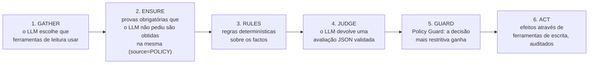

# 02 — Agentes

## O que é um "agente" neste sistema

Um agente é um componente com **um objetivo**, **ferramentas autorizadas**, **regras próprias** e,
quando é útil, **um LLM** para as partes que exigem interpretação. Cada execução fica registada
(`AgentExecution`) com tudo o que o agente viu, as ferramentas que usou, o que decidiu e porquê.

Não é um chat livre: o LLM nunca toca na base de dados diretamente. Só pode **pedir ferramentas**,
que verificam permissões e validam argumentos, e **dar uma avaliação estruturada** (JSON) que passa
pelo Policy Guard antes de produzir efeito.

## O ciclo de execução (BaseAgent)

Todos os agentes do workflow de aluguer seguem o mesmo ciclo (`agents/core/BaseAgent.ts`, padrão
*Template Method*):

| Passo | Quem | Detalhe |
|---|---|---|
| 1. GATHER | IA | O modelo vê só as ferramentas de leitura oferecidas ao agente e pode chamar várias, em ciclos, até `maxAgentSteps` (6). |
| 2. ENSURE | Código | O que o agente **não pode** decidir sem saber é obtido mesmo que o modelo se esqueça. A chamada fica marcada com `source = POLICY`. |
| 3. RULES | Código | Regras de negócio puras (`rules.ts` de cada agente), testadas em `tests/rules.test.ts`. |
| 4. JUDGE | IA | Pedido ao modelo com instruções, factos e o formato JSON exato. A resposta é validada com Zod; se for inválida há uma nova tentativa, e depois disso a avaliação fica `null`. Só acontece quando é útil (por exemplo, não há IA se uma regra já rejeitou). |
| 5. GUARD | Código | Combina regras e IA (ver abaixo). |
| 6. ACT | Código | Efeitos através de ferramentas de escrita (`confirmRental`, `openCase`, `createPayment`…), todos auditados. |

Se um agente falhar a meio, **nunca deixa passar o pedido**. A execução fica `FAILED`, o agente abre um
caso e o Approval Agent rejeita qualquer pedido com verificações incompletas.

## Policy Guard — "a IA pode restringir, nunca permitir"

`agents/core/policyGuard.ts`

1. **As regras ganham sempre.** Se uma regra diz `BLOCK`/`REJECT`/`ESCALATE`, a IA não a anula. Quando a
   IA era mais permissiva do que a regra, fica registado `policyOverride = true`, e o dashboard mostra-o.
2. **Lista de decisões autorizadas.** Cada agente tem as decisões que a IA pode tomar (por exemplo, o Risk
   Agent só pode `PROCEED` ou `ESCALATE`). Fora da lista, a decisão não é aceite.
3. **Limiar de confiança.** Uma decisão permissiva com confiança abaixo de **0,75** não é aceite.
4. **Sem resposta válida = restrição.** Uma resposta inválida ou em falta conta como sinalização
   (`ESCALATE`). Na decisão final, conta como rejeição.

Ordem de restrição: `PROCEED`/`APPROVE` < `ESCALATE` < `REJECT`/`BLOCK`.

## Ferramentas e permissões

As ferramentas (`backend/src/tools`) são **a única forma** de um agente ler ou alterar dados. O
`ToolSession`:
1. verifica se a ferramenta está na **lista de permissões do agente** (`tools/permissions.ts`); se não
   estiver, a chamada é **recusada (`DENIED`)**, registada e auditada;
2. valida os argumentos;
3. executa e regista o resultado e a duração (`AgentToolCall`).

| Agente | Ferramentas permitidas |
|---|---|
| Orchestrator | — (coordena, não toca em dados) |
| Rental | `getRentalRequest`, `getEquipment`, `checkEquipmentAvailability`, `openCase` |
| Maintenance | workflow: `getRentalRequest`, `getEquipment`, `getMaintenanceHistory`, `getOpenIssues`, `classifyIssue`, `updateEquipmentStatus`, `openCase`; monitorização: `getFleetMaintenanceStatus`, `getRecentIssueReports`, `createMaintenanceOrder`, `flagEquipmentForMaintenance`, `createAlert` |
| Risk | workflow: `getRentalRequest`, `getCustomer`, `getCustomerRentalHistory`, `checkDocuments`, `recordRiskAssessment`, `openCase`; monitorização: `getCustomerReturnPatterns`, `getOperationalConsistency`, `openAnomalyCase`, `createAlert` |
| Finance | workflow: `getRentalRequest`, `getCustomer`, `getCustomerPayments`, `createPayment`, `openCase`; monitorização: `getPaymentsOverview`, `markPaymentOverdue`, `getFinanceSummary`, `createAlert` |
| **Approval** | `getRentalRequest`, `getCaseFindings`, `checkEquipmentAvailability`, `getCustomer`, `getCustomerRentalHistory`, `getCustomerPayments`, **`confirmRental`**, `resolveCase`, `getPendingAnomalies`, `triageAnomaly` |
| Notification | `getRentalRequest`, `getCustomer`, `getReturnsSchedule`, `createNotification` |
| Assistant | `getMachineInfo`, `checkDatesAvailability`, `getRentalPolicy`, `getMyRequestStatus` (só leitura, só dados públicos) |
| Onboarding | — (recebe os factos do registo; o único efeito, o estado da conta, é auditado) |

Restrições que a tabela garante:
- **Só o Approval Agent pode aprovar um aluguer** (`confirmRental`) ou fechar casos.
- Nenhum agente pode voltar a pôr uma máquina `AVAILABLE` nem desbloquear um cliente.
- Só o Finance mexe em pagamentos e só o Maintenance abre ordens de trabalho.
- O Risk Agent pode sinalizar anomalias, mas não pode rejeitar nem bloquear sozinho.

---

## Os agentes

### Orchestrator
**Papel:** dono do **processo**, não das decisões. Corre o agente de cada passo e usa a decisão para
escolher o passo seguinte, a partir da tabela de transições em `orchestrator/workflow.ts`. Aplica
alterações de estado auditadas e regista cada encaminhamento no feed de atividade.
**IA:** nenhuma. A ordem do processo é política da empresa.
Ver [03 — Fluxos](03-fluxos.md).

### Rental Agent — passo `INTAKE`
- **Regras:** máquina retirada da frota, máquina já alugada no período, início no passado e período
  acima de 90 dias levam a `REJECT`.
- **IA:** lê o **uso previsto** escrito pelo cliente e avalia se é compatível com a máquina e se levanta
  alguma questão de segurança. Pode `PROCEED` ou `ESCALATE`, com `safetyFlags`. Sem texto, não chama a IA.
- **Ação:** se sinalizar, abre um caso (prioridade `HIGH` se houver alertas de segurança).

### Maintenance Agent — passo `MAINTENANCE_CHECK`
- **Regras:**
  - manutenção vencida ou máquina fora de serviço levam a `BLOCK`;
  - uma avaria `CRITICAL` aberta leva a `BLOCK`;
  - uma avaria `HIGH`, uma avaria por classificar ou uma revisão marcada para dentro do período do
    aluguer levam a `ESCALATE`.
- **IA:**
  - avalia o estado geral da máquina;
  - **classifica a gravidade** das avarias descritas em texto livre sem gravidade atribuída. A regra
    decide depois o que essa gravidade significa.
- **Particularidade:** o LLM é consultado **mesmo quando uma regra já bloqueia**, para o dashboard poder
  mostrar o Policy Guard a sobrepor-se a um modelo que deixaria sair uma máquina insegura.

### Risk & Compliance Agent — passo `RISK_ASSESSMENT`
- **Regras:**
  - cliente bloqueado leva a `REJECT`;
  - documentos em falta ou expirados, devoluções atrasadas, danos anteriores, valor acima de
    1 500 000 MZN e **email diferente do que está registado para o NUIT** levam a `ESCALATE`.
- **IA:** junta todos os sinais num **nível e pontuação de risco**, com as provas citadas e uma
  recomendação (por exemplo, "pedir caução"). Só pode `PROCEED` ou `ESCALATE`, nunca rejeitar.
- **Ação:** grava o risco no aluguer (`recordRiskAssessment`) e abre um caso se sinalizar.

### Finance Agent — passos `FINANCE_CHECK` e `BILLING`
- **Sem IA, de propósito:** "o cliente deve dinheiro?" é um facto, não uma opinião. Também mostra que
  nem todos os agentes precisam de IA.
- **FINANCE_CHECK (antes da aprovação):**
  - pagamentos em atraso levam a `ESCALATE`;
  - exposição de crédito (em dívida + este aluguer) acima do limite leva a `ESCALATE`;
  - numerário acima de 250 000 MZN leva a `ESCALATE`.
- **BILLING (depois da aprovação):** cria o pagamento associado ao aluguer, com vencimento no último dia.
  Uma falha aqui **não desfaz** uma aprovação.

### Approval Agent — passo `FINALIZE` (o decisor)
**Ninguém aprova nada à mão.** Os outros agentes levantam **sinalizações**; este agente lê o processo
inteiro e decide `APPROVE` (opcionalmente com **condições**) ou `REJECT`.

- **Regras (antes da IA), que levam sempre a `REJECT`:**
  - a máquina foi reservada por outro pedido entretanto;
  - uma verificação não terminou (um agente falhou);
  - uma sinalização **não anulável**: identidade (`identity.contact_mismatch`), dívida (`payments.overdue`),
    crédito (`credit.limit_exceeded`) ou avarias `HIGH`/`CRITICAL`.
- **IA:** sem sinalizações, aprova. Com sinalizações anuláveis, decide se o risco se pode mitigar com
  condições concretas ("apresentar seguro válido antes do levantamento", "pagar caução", "pagar por
  M-Pesa em vez de numerário", "período mais curto").
- **Fail-safe:** confiança abaixo de 0,75, resposta inválida ou falha do modelo levam a `REJECT`.
- **Ação:** `confirmRental` (aprova, grava as condições e reserva a máquina) e `resolveCase`.
- **Modo monitorização:** faz a triagem das anomalias abertas pelo Risk Agent. `FOLLOW_UP` mantém o alerta
  aberto; `DISMISS` fecha-o quando os dados o explicam. Na dúvida, **mantém a anomalia visível**.

### Notification Agent — passo `NOTIFY`
- **Regras:** **quem** recebe e **que tipo** de notificação recebe vêm do estado do aluguer e da base de
  dados, nunca do modelo nem do formulário público.
- **IA:** escreve a mensagem ao cliente, adaptada à decisão, ao motivo e às condições. Se o modelo falhar,
  usa um modelo de texto fixo, para que nenhuma notificação se perca por causa da IA.
- **Modo monitorização:** lembretes de devolução, avisos de atraso e um resumo para a operação **por ordem
  de prioridade**. `HIGH`/`CRITICAL` são enviados um a um e o resto num único resumo, para não cansar quem
  lê. Cada notificação tem uma chave de deduplicação.
- **Canais:** cada notificação a um cliente segue por **email** (SMTP). Quando o aluguer é **aprovado**, o cliente recebe também **um SMS** (MozeSMS) com o texto fixo "Equipamento alugado com sucesso" (sem acentos, 1 crédito), uma única vez por aluguer. Recusas, lembretes e avisos de pagamento vão só por email. Sem configuração, ambos ficam `SIMULATED`. O resultado (`SENT`/`FAILED` + motivo) fica registado e visível em Alerts & Notifications. Uma falha do gateway nunca interrompe um agente.

### Onboarding Agent — registo de clientes
Valida cada **autorregisto** de cliente. **0% humano.**
- **Regras (`agents/onboarding/rules.ts`), que levam a `REJECT`:**
  - NUIT de um cliente bloqueado;
  - NUIT já registado com **outro email** (impede que alguém se apodere da conta de outra empresa);
  - email descartável (mailinator, yopmail…).
- **IA:** verifica se os dados parecem genuínos e coerentes (nome da empresa, contacto, email, telefone) e
  rejeita dados obviamente falsos ou de teste. Só pode `APPROVE` ou `REJECT`.
- **Fail-safe:** confiança baixa, resposta inválida ou falha levam a `REJECT`. Uma tentativa rejeitada de
  reclamar uma empresa existente **não deixa** as credenciais de quem tentou no registo verdadeiro.
- **Ação:** conta `ACTIVE` ou `REJECTED`, com o motivo (que o cliente vê), e auditoria.

### Customer Assistant — chat nas páginas do QR
- Responde **só** com o que as ferramentas devolvem: dados da máquina, disponibilidade em datas,
  política de aluguer e estado do próprio pedido.
- A máquina e o pedido são **fixados pelo servidor**; o modelo não consegue consultar outros.
- Não pode aprovar, alterar nem cancelar nada.
- As datas em linguagem natural ("próxima semana", "12/10/2026") são calculadas em código, não pelo modelo.
- Cada mensagem é uma `AgentExecution`, como qualquer outro agente.

### Documents (reservado)
Existe no modelo de dados (fotografias de documentos e dados extraídos), mas ainda não está ativo e
não tem ferramentas. É um próximo passo natural: um modelo de visão (`LLM_VISION_MODEL`) a ler fotografias
de documentos.

---

## Modo monitorização (agentes proativos)

Os mesmos agentes têm um segundo modo, `MonitoringAgent`, ativado pelo **ciclo de monitorização** e não
por um pedido. Cada um analisa a operação, aplica regras (e IA onde há texto), age através de ferramentas e
devolve **achados** (`findings`) que passam para os agentes seguintes.

| Agente | Deteta (regras) | IA |
|---|---|---|
| Maintenance | Horas de motor acima de 90% do intervalo de revisão; revisões a vencer em 14 dias. Cria ordens de trabalho e marca `MAINTENANCE_PENDING` | Lê relatos de avaria da mesma máquina (180 dias) e decide se descrevem **o mesmo problema recorrente**, escrito de formas diferentes |
| Finance | Pagamentos vencidos (marca `OVERDUE`); alugueres que acabam amanhã com dinheiro em dívida; totais | — |
| Risk | 3 atrasos nos últimos 5 alugueres; máquinas não devolvidas; estado `RENTED` sem aluguer; leituras acima de 24 h/dia | Explica cada anomalia em **linguagem neutra**. Um *language guard* substitui e regista qualquer formulação acusatória |
| Approval | Anomalias pendentes | Triagem `FOLLOW_UP`/`DISMISS` (na dúvida mantém) |
| Notification | Devoluções amanhã/hoje/em atraso; achados do ciclo | Escreve as mensagens |

Os alertas e casos têm **chaves de deduplicação**, por isso a mesma situação vista em vários ciclos não gera
alertas repetidos.

## Como acrescentar um agente

1. Cria `agents/<nome>/rules.ts` com regras puras e testes em `tests/rules.test.ts`.
2. Cria a classe a estender `BaseAgent` (workflow) ou `MonitoringAgent` (proativo): `goal`, `offeredTools`,
   `requiredFacts`, `llmDecisions`, `judgementRequest`, `act`.
3. Acrescenta o nome ao enum `AgentName` (`schema.prisma`) e cria uma migração.
4. Define as ferramentas permitidas em `tools/permissions.ts`.
5. Liga-o ao Orchestrator: um passo novo em `workflow.ts` e `Orchestrator.agents`, ou na lista `monitors`.
6. No frontend, acrescenta a etiqueta e o ícone em `utils/agents.ts` e o nome em `types/index.ts`.
