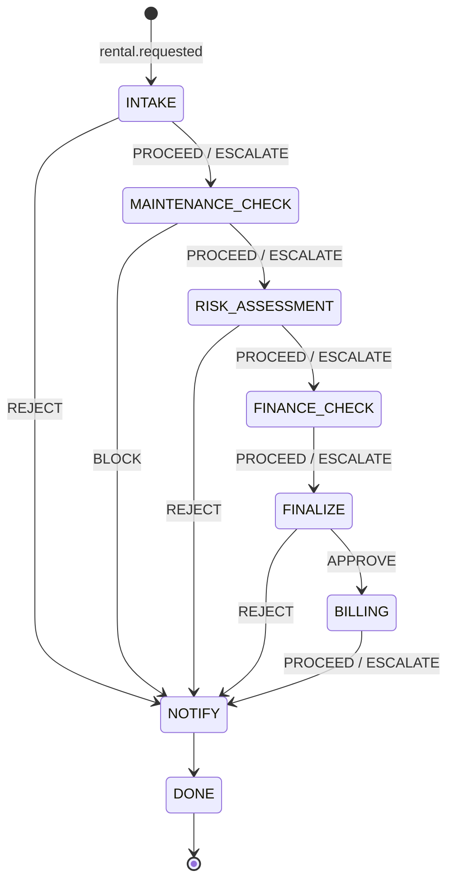
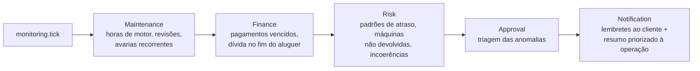
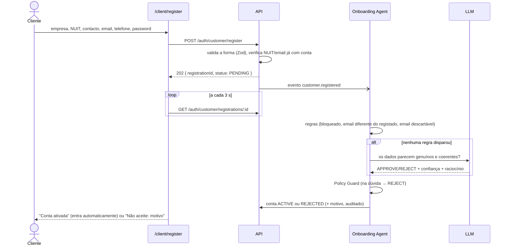

# 03 — Fluxos

## 1. Pedido de aluguer por QR code

### Do lado do cliente

1. O cliente lê o QR code colado na máquina e abre `/equipment/EQP-001`.
2. Vê a máquina, o preço por dia e o estado, e preenche:
   - empresa e NUIT;
   - contacto, email e telefone;
   - datas;
   - uso previsto;
   - método de pagamento.

   Se tiver sessão iniciada no portal, a empresa e o NUIT vêm da conta.
3. Envia o pedido. A API grava-o e responde **`202 Accepted`**, e o cliente passa para
   `/requests/:id`, onde acompanha o progresso (atualiza sozinha).
4. No fim vê a decisão, a mensagem escrita para ele e as condições, se as houver.

O NUIT identifica a empresa. Se já existir, o pedido fica associado a esse cliente, mas **o registo
existente nunca é alterado** a partir do formulário público. O que foi escrito fica guardado no próprio
pedido e o Risk Agent compara-o com o que está registado.

### Do lado do sistema: máquina de estados

A ordem do processo está numa tabela em `backend/src/agents/orchestrator/workflow.ts`:



| Passo | Agente | IA? |
|---|---|---|
| `INTAKE` | Rental Agent | Sim, para avaliar o uso previsto |
| `MAINTENANCE_CHECK` | Maintenance Agent | Sim, para o estado da máquina e a gravidade das avarias |
| `RISK_ASSESSMENT` | Risk & Compliance Agent | Sim, para o nível de risco |
| `FINANCE_CHECK` | Finance Agent | Não |
| `FINALIZE` | **Approval Agent** | Sim: **decisão final** |
| `BILLING` | Finance Agent | Não |
| `NOTIFY` | Notification Agent | Sim, para redigir a mensagem |

Regras do encaminhamento:
- **`ESCALATE` não para o fluxo.** É uma **sinalização** que segue com o pedido; todas as verificações
  continuam a correr e o Approval Agent pesa-as em conjunto no fim.
- **`REJECT` e `BLOCK` acabam o fluxo** de imediato. O pedido fica `REJECTED` e passa para `NOTIFY`, para o
  cliente ser informado.
- **Uma decisão inesperada nunca deixa passar o pedido.** Se um agente devolve algo que a tabela não prevê,
  o pedido é rejeitado. A exceção é o `BILLING`, que acontece depois de aprovado: uma falha aí não desfaz a
  aprovação.
- **Estados do aluguer:** `REQUESTED` → `IN_REVIEW` → `APPROVED` ou `REJECTED`. Os estados `ACTIVE`
  (máquina levantada) e `COMPLETED` (devolvida) existem no modelo e nos dados de demonstração, mas o
  levantamento e a devolução **ainda não têm ecrã nem endpoint** (ver as limitações em
  [09](09-apresentacao-perguntas.md)).
- **Aprovação:** a ferramenta `confirmRental` (só do Approval Agent) põe o aluguer em `APPROVED`, grava as
  condições e põe a máquina em `RESERVED`.
- **Retoma:** o passo atual está gravado no aluguer (`workflowStep`). Se o servidor reiniciar, os pedidos
  `REQUESTED`/`IN_REVIEW` continuam do ponto onde estavam.

### Exemplo: o que fica registado

Para o pedido `RNT-2026-0012`, o feed de Agent Activity mostra, por ordem:

```
Orchestrator      Workflow started for RNT-2026-0012 — routing to Rental Agent
Rental Agent      Request validated — Escavadora CAT 320 available 2026-10-14 → 2026-10-20     PROCEED
Orchestrator      Routing to Maintenance Agent
Maintenance Agent ...                                                                           PROCEED
Risk Agent        ... documentation incomplete: Insurance certificate expired ...              ESCALATE
Orchestrator      Flag raised by risk — continuing. Routing to Finance Agent
Finance Agent     ...                                                                           PROCEED
Approval Agent    Approved by AI (confidence 85%) with 1 condition(s)                          APPROVE
Finance Agent     Payment PAY-2026-00xx of 210 000 MZN registered, due 2026-10-20               PROCEED
Notification Agent ...                                                                          NONE
Orchestrator      Workflow completed for RNT-2026-0012 — approved
```

Em cada linha pode-se abrir o **trace**: factos, ferramentas chamadas (com argumentos, resultado, duração e
origem `LLM`/`POLICY`/`AGENT`), raciocínio, confiança, tokens e se o Policy Guard se sobrepôs à IA.

## 2. Ciclo de monitorização (proativo)

Corre a cada 15 minutos (`MONITORING_INTERVAL_MS`) ou pelo botão **Run monitoring now** do dashboard.
Só corre um ciclo de cada vez.



Cada agente recebe os **achados** dos anteriores. É assim que a informação passa entre agentes, por
exemplo para o Notification Agent saber o que reportar. Alertas, casos e notificações são **deduplicados**:
a mesma situação não gera um alerta novo a cada ciclo.

## 3. Registo de cliente (autorregisto)



Casos:

| Situação | Resultado |
|---|---|
| NUIT novo, dados coerentes | Conta nova `ACTIVE` (se a IA aprovar com confiança ≥ 0,75) |
| NUIT que já existe (criado pelo admin ou por um pedido QR) **com o email registado** | A conta é associada ao cliente existente, com o histórico. Os dados da empresa **não** são alterados |
| NUIT que já existe com **outro email** | `REJECTED` (impede que alguém se apodere da conta de outra empresa) |
| NUIT que já tem conta ativa ou pendente | `409` imediato: "faça login" |
| Email descartável | `REJECTED` |
| Cliente bloqueado | `REJECTED` |
| IA indecisa, resposta inválida ou falha | `REJECTED` (fail-safe) |
| Registo rejeitado | O cliente pode corrigir e tentar de novo |

Se o servidor reiniciar a meio, os registos `PENDING` são retomados no arranque.

## 4. Login

| Quem | Página | Depois do login |
|---|---|---|
| Equipa (Admin, Operator) | `/login` | `/dashboard` (ou a página pedida antes) |
| Cliente com conta `ACTIVE` | `/client/login` | `/client` (portal) ou a página do QR de onde veio |

Uma conta de cliente `PENDING` não entra ("ainda em validação"); uma `REJECTED` vê o motivo.
Detalhes em [07 — Segurança](07-seguranca.md).

## 5. Assistente de cliente (chat)

Nas páginas do QR há um chat. Cada mensagem vai para `POST /public/equipment/:code/assistant` com o
histórico (até 12 mensagens, guardado no browser). O assistente:
1. recebe a máquina e, na página de estado, o pedido, ambos **fixados pelo servidor**;
2. escolhe ferramentas de leitura (dados da máquina, disponibilidade, política, estado do pedido);
3. responde só com base nesses dados.

Não tem ferramentas de escrita, por isso não consegue aprovar, alterar nem cancelar nada.
