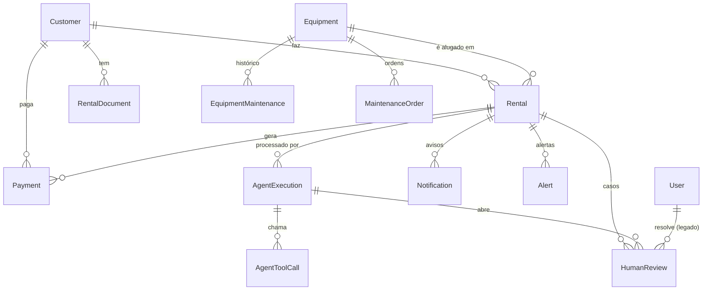

# 06 — Modelo de dados

PostgreSQL com Prisma. A fonte de verdade é [`backend/prisma/schema.prisma`](../backend/prisma/schema.prisma);
o histórico está em `backend/prisma/migrations/`. Todos os valores monetários são `Decimal` em **MZN**.

## Diagrama

## Domínio

### `User`: equipa (dashboard)
| Campo | Descrição |
|---|---|
| `name`, `email` (único) | Identificação |
| `role` | `ADMIN`, `OPERATOR` (`REVIEWER` é legado, não é usado no modo autónomo) |
| `passwordHash` | scrypt `salt:hash`. **Nunca sai da API**: está excluído por omissão em todas as consultas |
| `isActive` | `false` = não pode entrar; a sessão em curso deixa de funcionar de imediato |
| `lastLoginAt` | Último login |

### `Customer`: empresa cliente
| Campo | Descrição |
|---|---|
| `code` | `CUS-001`, … |
| `taxId` (único) | **NUIT**: identifica a empresa |
| `companyName`, `contactName`, `email`, `phone` | Dados registados. O `email` é o que o Risk Agent compara com o do formulário |
| `country` | País do contacto (ISO 2 letras, `MZ` por omissão) |
| `isBlocked` | Cliente bloqueado: os pedidos são rejeitados por regra |
| `creditLimit` | Limite de crédito (MZN), opcional |
| `loginEmail` (único) | Email de acesso ao portal |
| `passwordHash` | Password do portal (excluída por omissão, como em `User`) |
| `accountStatus` | `null` (sem conta), `PENDING`, `ACTIVE`, `REJECTED` |
| `accountDecisionReason` | Porque o Onboarding Agent ativou ou rejeitou a conta (o cliente vê-o) |
| `accountRequestedAt` | Data do pedido de conta |

Há três formas de um cliente entrar no sistema: o admin regista-o, o primeiro pedido pelo QR cria-o, ou o
próprio cliente regista-se no portal.

### `Equipment`: máquina
| Campo | Descrição |
|---|---|
| `code` | `EQP-001`, …: é o que está codificado no QR (`/equipment/{code}`) |
| `type` | Escavadora, bulldozer, grua, gerador, etc. |
| `status` | `AVAILABLE`, `RESERVED`, `RENTED`, `MAINTENANCE_PENDING`, `MAINTENANCE`, `BLOCKED`, `RETIRED` |
| `dailyRate` | Preço por dia (MZN) |
| `lastMaintenanceAt`, `nextMaintenanceDue` | Revisões por data |
| `usageHours`, `hoursAtLastService`, `serviceIntervalHours` | Revisões por horas de motor |
| `requiresOperatorLicense` | Exige a licença de operador do cliente |

### `Rental`: pedido e aluguer
| Campo | Descrição |
|---|---|
| `code` | `RNT-2026-0001` |
| `startDate`, `endDate`, `dailyRate` (instantâneo), `totalAmount` | Período e valor |
| `intendedUse` | Texto livre do cliente (avaliado pela IA) |
| `contactName`, `contactEmail`, `contactPhone`, `contactCountry` | O que foi escrito no formulário, **nunca copiado** para o cliente |
| `paymentMethod` | `MPESA`, `EMOLA`, `BANK_TRANSFER`, `CARD`, `CASH` |
| `status` | `REQUESTED`, `IN_REVIEW`, `APPROVED`, `REJECTED`, `ACTIVE`, `COMPLETED`, `CANCELLED` (`REQUIRES_HUMAN_REVIEW` é legado) |
| `workflowStep` | Passo atual: `INTAKE` … `NOTIFY`, `DONE` (permite retomar) |
| `riskLevel`, `riskScore` | Avaliação do Risk Agent |
| `approvalConditions` | Condições impostas pelo Approval Agent |
| `decisionReason` | Motivo interno da decisão |
| `customerMessage` | Explicação para o cliente, escrita pelo Notification Agent |
| `decidedByAgent`, `decidedAt` | Quem decidiu e quando |
| `actualReturnAt`, `lateDays`, `damageReported`, `damageNotes`, `hoursUsed` | Factos da devolução: o histórico que o Risk Agent lê |

### `RentalDocument`
Documentos do cliente: `ID_DOCUMENT`, `INSURANCE_CERTIFICATE`, `OPERATOR_LICENSE`,
`COMPANY_REGISTRATION`, cada um com o estado `PENDING_VERIFICATION`, `VALID`, `EXPIRED` ou `REJECTED` e a
validade. Com `rentalId = null`, é um documento do cliente reutilizado em todos os alugueres. Os campos
`fileUrl` e `extractedData` estão reservados para o futuro Document Agent (fotografias).

### `MpesaTransaction`
Cada pedido de pagamento M-Pesa (C2B): número, valor, as nossas referências, a resposta da Vodacom
(`responseCode`, `providerTransactionId`) e o estado `PENDING`/`SUCCESS`/`FAILED`. Quando é pago, é criado um
`Payment` `PAID` com o valor do sinal e o pagamento pendente do aluguer é reduzido.

### `Payment`
`reference` (`PAY-2026-0001`), `amount`, `dueDate` (último dia do aluguer), `status` (`PENDING`, `PAID`,
`OVERDUE`, `CANCELLED`), `method`, `paidAt`.

### `EquipmentMaintenance` e `MaintenanceOrder`
- **EquipmentMaintenance:** histórico de revisões, inspeções, reparações e **relatos de avaria**. Um relato
  novo não tem `severity`; classificá-lo é tarefa da IA do Maintenance Agent.
- **MaintenanceOrder:** ordens de trabalho (`MO-2026-0001`), do tipo `PREVENTIVE`, `CORRECTIVE` ou
  `INSPECTION`, com prioridade e o agente que as criou.

## Observabilidade e auditoria

### `AgentExecution`: uma execução de um agente
| Campo | Descrição |
|---|---|
| `agent`, `step`, `trigger` | Quem, em que passo, e porquê (`rental.requested`, `schedule`, `customer.registered`…) |
| `correlationId` | Agrupa as execuções: id do aluguer, id do ciclo (`MON-…`) ou id do cliente (registo) |
| `status` | `RUNNING`, `SUCCEEDED`, `FAILED` |
| `decision` | `PROCEED`, `APPROVE`, `REJECT`, `BLOCK`, `ESCALATE`, `NONE` |
| `summary`, `reasoning`, `confidence` | Resumo para o feed, raciocínio e confiança da IA |
| `input`, `output` | Factos e resultado (JSON) |
| `usedLLM`, `model`, `inputTokens`, `outputTokens` | Consumo de IA |
| `policyOverride` | `true` quando as regras se sobrepuseram a uma IA mais permissiva |
| `durationMs`, `error` | Desempenho e erros |

### `AgentToolCall`
Cada ferramenta chamada: `toolName`, `arguments`, `result`, `status` (`SUCCESS`, `ERROR`, **`DENIED`**),
`durationMs` e `source`, que diz quem decidiu chamá-la (`LLM`, `POLICY` ou `AGENT`).

### `HumanReview`: casos
O nome é histórico. No modo autónomo são **casos** abertos pelos agentes (sinalizações e anomalias) e
**resolvidos pelo Approval Agent** (`resolvedByAgent`). Guarda os factos que o agente viu (`analyzedData`),
a ação recomendada, a prioridade e a resolução.

### `Alert` e `Notification`
- **Alert:** alertas operacionais com `severity`, `category`, agente de origem e estado (`OPEN`,
  `ACKNOWLEDGED`, `RESOLVED`).
- **Notification:** mensagens a clientes e à operação, com o canal (`EMAIL`, `SMS`, `INTERNAL`), a
  prioridade e o estado `SIMULATED` (não há envio real).
- Ambos têm `dedupeKey` único, para que a mesma situação não gere duplicados.

### `AuditLog`
Registo de todas as alterações: `actorType` (`AGENT`, `USER`, `SYSTEM`), `actorId`, `action` (por exemplo
`rental.status_changed`, `customer.account_activated`, `user.login`), entidade, `before`/`after` e
`correlationId`.

## Migrações

| Migração | Conteúdo |
|---|---|
| `20261001181542_init` | Modelo inicial |
| `20261002121919_tool_call_source` | Origem das chamadas a ferramentas (`LLM`/`POLICY`/`AGENT`) |
| `20261002190000_finance_monitoring_mzn` | Pagamentos, ordens de manutenção, monitorização, MZN |
| `20261003200000_qr_customer_details_payment_method` | Dados de contacto e método de pagamento no pedido |
| `20261003220000_ai_approval_agent` | Approval Agent e modo autónomo |
| `20261004100000_customer_assistant` | Assistente de cliente |
| `20261004120000_document_agent` | Campos para o Document Agent (reservado) |
| `20261004120100_customer_message` | Mensagem ao cliente no aluguer |
| `20261013120000_customer_accounts_auth` | Passwords, contas de cliente, Onboarding Agent |
| `20261013180000_email_gateway` | Resultado do envio de email nas notificações (`sentAt`, `providerMessageId`, `deliveryError`) |
| `20261014090000_contact_country` | País do contacto no cliente e no pedido |
| `20261014150000_mpesa_transactions` | Transações M-Pesa |
| `20261014150000_mpesa_transactions` | Transações M-Pesa |
